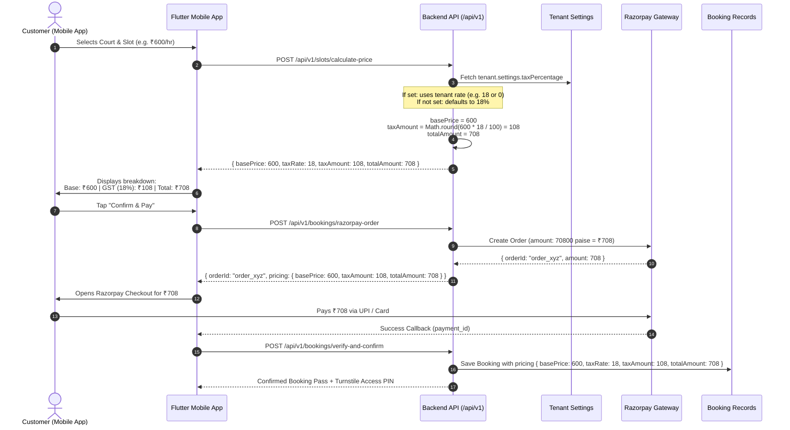

# 💰 Pricing, GST & Tax Architecture Specification

Complete technical and business reference explaining **why GST is applied**, **how it is calculated on the backend**, and **how multi-tenant tax configuration works** across the platform.

---

## 📌 Executive Summary

### 1. Why is GST applied?
In India, commercial sports facility operations (renting badminton courts, football turfs, cricket nets, pickleball arenas, tennis courts) are categorized under:
- **SAC (Services Accounting Code) 9996 / 9984**: Recreational, cultural, and sporting services.
- **Statutory GST Rate**: **18%** (split as **9% CGST + 9% SGST** for intra-state bookings).
- Registered sports facilities collect this tax and issue a formal GST invoice / receipt.

### 2. Is the Frontend applying GST or does it come from the Backend?
> **GST is 100% calculated, enforced, and stored by the BACKEND.**

- The **Backend** is the single source of truth for all pricing, taxes, and Razorpay orders.
- The backend checks each facility's configuration (`tenant.settings.taxPercentage`).
- When a booking or order is created, the backend calculates:
  $$\text{taxAmount} = \text{round}\left(\frac{\text{basePrice} \times \text{taxRate}}{100}\right)$$
  $$\text{totalAmount} = \text{basePrice} + \text{taxAmount} - \text{discountAmount}$$
- The mobile frontend receives these exact values in the `pricing` object and displays them to the user.

### 3. Can GST be turned off or set to 0%?
**Yes!** If a facility is:
- Below the GST registration threshold (₹20 Lakhs / ₹40 Lakhs annual turnover), OR
- Operates on an all-inclusive pricing model (tax included in court rate),
Then setting `tenant.settings.taxPercentage = 0` in the database / tenant settings will automatically:
- Set `taxRate = 0`
- Set `taxAmount = 0`
- Set `totalAmount = basePrice` (no extra tax added at checkout).

---

## 🏗️ Architecture & Calculation Flow



---

## 💻 Backend Implementation Details

### Where the calculation lives:
1. **Slot Quote Estimation**: [backend/src/modules/slots/slot.service.js](file:///e:/amd_play/backend/src/modules/slots/slot.service.js#L683-L704)
2. **Direct Booking Creation**: [backend/src/modules/bookings/booking.service.js](file:///e:/amd_play/backend/src/modules/bookings/booking.service.js#L101-L107)
3. **Razorpay Order Generation**: [backend/src/modules/bookings/booking.service.js](file:///e:/amd_play/backend/src/modules/bookings/booking.service.js#L496-L502)

### Backend Calculation Logic:
```javascript
// 1. Fetch Tenant's customized tax setting
const tenant = await tenantRepository.findById(tenantId);
const taxRate = tenant?.settings?.taxPercentage ?? 18; // Defaults to 18% GST if not configured

// 2. Compute base price from court dynamic tier (peak / off-peak / weekend)
const basePrice = pricingDetails.finalPrice;

// 3. Compute tax amount and final total
const taxAmount = Math.round((basePrice * taxRate) / 100);
const discountAmount = 0;
const totalAmount = basePrice + taxAmount - discountAmount;
```

---

## 🏢 Multi-Tenant Tax Modes

| Facility Type | `tenant.settings.taxPercentage` | Breakdown for a ₹600 Slot | Checkout Display |
| :--- | :---: | :--- | :--- |
| **GST-Registered Facility** *(Default)* | `18` | Base: ₹600<br/>GST (18%): ₹108<br/>**Total: ₹708** | Shows Base Rate + GST row |
| **Unregistered / Small Turf / Tax-Exempt** | `0` | Base: ₹600<br/>GST: ₹0<br/>**Total: ₹600** | Only shows Base Rate (no extra tax) |
| **Concessional Rate** (e.g. state exemption) | `5` or `12` | Base: ₹600<br/>GST: ₹30 or ₹72<br/>**Total: ₹630 / ₹672** | Shows configured % |

---

## 📡 API Contracts & Payloads

### 1. Price Quote API: `POST /api/v1/slots/calculate-price`
- **Request**:
  ```json
  {
    "resourceId": "67a200000000000000000010",
    "date": "2026-10-15",
    "startTime": "18:00",
    "endTime": "19:00"
  }
  ```
- **Response (`200 OK`)**:
  ```json
  {
    "success": true,
    "data": {
      "resourceId": "67a200000000000000000010",
      "resourceName": "Badminton Court 1",
      "date": "2026-10-15",
      "startTime": "18:00",
      "endTime": "19:00",
      "basePrice": 600,
      "taxRate": 18,
      "taxAmount": 108,
      "discountAmount": 0,
      "totalAmount": 708,
      "currency": "INR"
    }
  }
  ```

### 2. Razorpay Order API: `POST /api/v1/bookings/razorpay-order`
- **Request**:
  ```json
  {
    "courtId": "67a200000000000000000010",
    "date": "2026-10-15",
    "startTime": "18:00",
    "endTime": "19:00"
  }
  ```
- **Response (`201 Created`)**:
  ```json
  {
    "success": true,
    "data": {
      "orderId": "order_NXrA78291039",
      "keyId": "rzp_test_51aXl9Y02",
      "amount": 708,
      "amountInPaise": 70800,
      "currency": "INR",
      "receipt": "bk_91038201",
      "pricing": {
        "basePrice": 600,
        "taxRate": 18,
        "taxAmount": 108,
        "discountAmount": 0,
        "totalAmount": 708
      }
    }
  }
  ```

---

## 📱 Mobile App UI Best Practice

Rather than hardcoding `tax = basePrice * 0.18`, the mobile app adopts dynamic pricing from the backend quote:

1. **When `taxAmount > 0`**:
   - Displays:
     - `Slot Base Rate: ₹600`
     - `GST (18% SGST/CGST): ₹108`
     - `Total Amount: ₹708`
2. **When `taxAmount == 0`** (e.g. tenant has `taxPercentage = 0`):
   - Hides the GST row completely.
   - Displays:
     - `Slot Rate: ₹600`
     - `Total Amount: ₹600`

---

## 📝 Summary Checklist

- [x] **GST Origin Verified**: Calculated and enforced by the **Backend** (`booking.service.js` & `slot.service.js`).
- [x] **Statutory Reason Documented**: 18% GST (9% CGST + 9% SGST) for SAC 9996 / 9984 sporting & recreational facility rentals.
- [x] **Multi-Tenant Flexibility**: Controlled dynamically via `tenant.settings.taxPercentage` (can be set to `0` for tax-inclusive or non-GST facilities).
- [x] **Documentation Created**: Available at `mobile_app/DOCS_PRICING_AND_GST_SPECIFICATION.md`.
