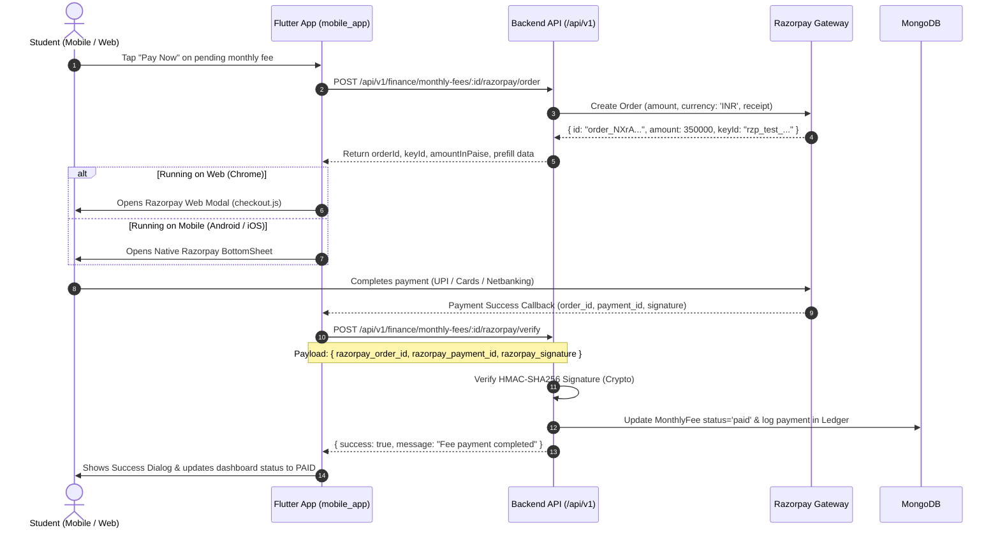

# 💳 Razorpay Payment Gateway Integration & Troubleshooting Guide

Complete technical reference and architecture documentation for the Sports Academy Student Monthly Coaching Fee Payment Integration across **Flutter Mobile (Android/iOS)** and **Flutter Web (Chrome)**.

---

## 📌 Table of Contents
1. [Overview & Root Cause Diagnosis](#1-overview--root-cause-diagnosis)
2. [End-to-End Two-Step Payment Architecture](#2-end-to-end-two-step-payment-architecture)
3. [Cross-Platform Implementation Details](#3-cross-platform-implementation-details)
4. [Backend API Reference](#4-backend-api-reference)
5. [Environment & Credentials Configuration](#5-environment--credentials-configuration)
6. [Testing & Sandbox Verification](#6-testing--sandbox-verification)

---

## 1. Overview & Root Cause Diagnosis

### Why did the error `"NoSuchMethodError: tried to call a non-function, such as null: 'dart.global.openRazorpayWebCheckout'"` occur?

| Layer | Root Cause | Solution Implemented |
| :--- | :--- | :--- |
| **Frontend (JS Binding & Hot Reload)** | In Dart JS-Interop, top-level `@JS('openRazorpayWebCheckout')` bindings expect `window.openRazorpayWebCheckout` to exist in the global browser context before invocation. When running on Flutter Web without a full browser reload, the function was null. | Upgraded [razorpay_bridge_web.dart](file:///e:/amd_play/mobile_app/lib/core/services/razorpay_bridge_web.dart) to automatically inject the Razorpay SDK script and self-initialize `window.openRazorpayWebCheckout` using `dart:js_interop_unsafe` and dynamic evaluation. |
| **Platform Compatibility** | `razorpay_flutter` native package only supports Android & iOS channels and throws `MissingPluginException` on Web. | Implemented a dual-runtime adapter (`kIsWeb` branch uses Web JS checkout modal, while Mobile runs native `_razorpay.open(...)`). |
| **Backend Mock Keys** | `RAZORPAY_KEY_ID=rzp_test_mock` is invalid for Razorpay CDN scripts. | Added an interactive **Developer Sandbox Fallback Dialog** when mock keys are detected, while automatically launching the live Razorpay popup when valid `rzp_test_*` credentials are provided. |

---

## 2. End-to-End Two-Step Payment Architecture



---

## 3. Cross-Platform Implementation Details

### 3.1 Web Bridge ([razorpay_bridge_web.dart](file:///e:/amd_play/mobile_app/lib/core/services/razorpay_bridge_web.dart))
- **Auto-Injection**: Injects `<script src="https://checkout.razorpay.com/v1/checkout.js"></script>` dynamically if missing from `<head>`.
- **Safe Invocation**: Uses `globalContext.callMethod('openRazorpayWebCheckout'.toJS, ...)` with fallback timeout polling to ensure the Razorpay CDN script has completely parsed before launching.
- **Callbacks**: Translates JavaScript checkout responses and dismiss events directly into Dart closures.

### 3.2 Mobile Implementation ([home_controller.dart](file:///e:/amd_play/mobile_app/lib/features/home/presentation/controllers/home_controller.dart))
- Initializes `Razorpay` instance when `!kIsWeb`.
- Listens to `EVENT_PAYMENT_SUCCESS`, `EVENT_PAYMENT_ERROR`, and `EVENT_EXTERNAL_WALLET`.
- Disposes resources cleanly in `onClose()`.

---

## 4. Backend API Reference

### 4.1 Create Payment Order (Step 1)
- **Method & Route**: `POST /api/v1/finance/monthly-fees/:id/razorpay/order`
- **Headers**:
  ```http
  Authorization: Bearer <Student_JWT_Token>
  Content-Type: application/json
  ```
- **Response (`200 OK`)**:
  ```json
  {
    "success": true,
    "message": "Razorpay order created successfully",
    "data": {
      "orderId": "order_Q123456789abcd",
      "keyId": "rzp_test_1DP5mmOlF5G5ag",
      "amount": 2000,
      "amountInPaise": 200000,
      "currency": "INR",
      "feeId": "67a500000000000000000001",
      "month": 10,
      "year": 2026,
      "student": {
        "id": "67a200000000000000000002",
        "name": "keshika devan",
        "email": "keshika@example.com",
        "phone": "9845099999",
        "regNo": "1001"
      },
      "batch": {
        "id": "67a400000000000000000004",
        "name": "Badminton - Weekdays 3 Days"
      }
    }
  }
  ```

#### Live Console Debug Output:
```text
=====================================================
🚀 [RAZORPAY ORDER REQUEST]
Endpoint: POST /api/v1/finance/monthly-fees/67a500000000000000000001/razorpay/order
Fee ID: 67a500000000000000000001
=====================================================
-----------------------------------------------------
📦 [RAZORPAY ORDER API RESPONSE]:
{
  "success": true,
  "message": "Razorpay order created successfully",
  "data": {
    "orderId": "order_Q123456789abcd",
    "keyId": "rzp_test_1DP5mmOlF5G5ag",
    "amount": 2000,
    "amountInPaise": 200000,
    "currency": "INR",
    "feeId": "67a500000000000000000001",
    "student": {
      "name": "keshika devan",
      "phone": "9845099999"
    }
  }
}
-----------------------------------------------------
✅ Extracted Razorpay Order Details:
   - Order ID: order_Q123456789abcd
   - Key ID: rzp_test_1DP5mmOlF5G5ag
   - Amount (Paise): 200000 (₹2000)
   - Student: keshika devan (9845099999)
   - Batch: Badminton - Weekdays 3 Days
```

---

### 4.2 Verify Payment & Complete Fee (Step 2)
- **Method & Route**: `POST /api/v1/finance/monthly-fees/:id/razorpay/verify`
- **Headers**:
  ```http
  Authorization: Bearer <Student_JWT_Token>
  Content-Type: application/json
  ```
- **Request Body**:
  ```json
  {
    "razorpay_order_id": "order_Q123456789abcd",
    "razorpay_payment_id": "pay_Q123456789efgh",
    "razorpay_signature": "59b83b3e0c46014e304b7cd9be3a12a52b821434c0fbbf3f34560d2b770387b3"
  }
  ```
- **Response (`200 OK`)**:
  ```json
  {
    "success": true,
    "message": "Coaching fee payment verified and completed successfully",
    "data": {
      "invoice": {
        "_id": "67a500000000000000000001",
        "status": "paid",
        "paidAmount": 2000,
        "paidAt": "2026-10-08T07:45:00.000Z",
        "razorpayOrderId": "order_Q123456789abcd",
        "razorpayPaymentId": "pay_Q123456789efgh",
        "notes": "Paid via Razorpay (pay_Q123456789efgh)"
      }
    }
  }
  ```

---

## 5. Environment & Credentials Configuration

To enable your live or test Razorpay account, configure the following keys in `backend/.env`:

```env
# Razorpay Credentials (from https://dashboard.razorpay.com/app/keys)
RAZORPAY_KEY_ID=rzp_test_your_actual_key_id
RAZORPAY_KEY_SECRET=your_actual_secret_key
RAZORPAY_WEBHOOK_SECRET=your_actual_webhook_secret
```

After updating `.env`, restart the backend server:
```bash
npm run dev
```

---

## 6. Live Payment Receipts & Invoices

All payment receipts and tax invoices are generated directly from live database records and Razorpay transaction settlements:

- **Endpoint**: `GET /api/v1/students/my/fees`
- **Model Properties**:
  - `receiptNumber`: Generated formatted receipt serial (e.g., `REC-FEE-...`)
  - `status`: Settled (`paid`) vs Pending/Overdue
  - `paidAt`: Exact timestamp of verification
  - `razorpayPaymentId`: Verified Razorpay transaction ID (`pay_...`)
  - `razorpayOrderId`: Associated Razorpay order ID (`order_...`)
  - `paidAmount`, `baseFee`, `discountAmount`: Itemized breakdown
- **Live Receipt UI**:
  - **Payments & Receipts Tab**: Displays 3 live segmented views (`All Invoices`, `Pending Dues`, `Paid Receipts`) with real-time pending dues and settled revenue metrics.
  - **Receipt Viewer Modal**: Clicking **"View Live Receipt"** on any settled fee launches the official Tax Invoice modal showing trainee credentials, batch details, transaction IDs, breakdown, and download/share actions.

---

## 7. Testing & Sandbox Verification

1. **Flutter Web**:
   - Run the app: `flutter run -d chrome`
   - Log in as a trainee (e.g. `regNo: 1001`, `password: Isa@123`).
   - Navigate to the **Payments & Receipts** tab or tap **Invoices & Payment Receipts** in Profile.
   - For pending dues, tap **Pay with Razorpay** to complete live checkout.
   - For paid fees, tap **View Live Receipt** to inspect the official receipt modal.
2. **Automated Unit & Widget Tests**:
   ```bash
   flutter test
   ```
   *Result: 11/11 tests pass.*
