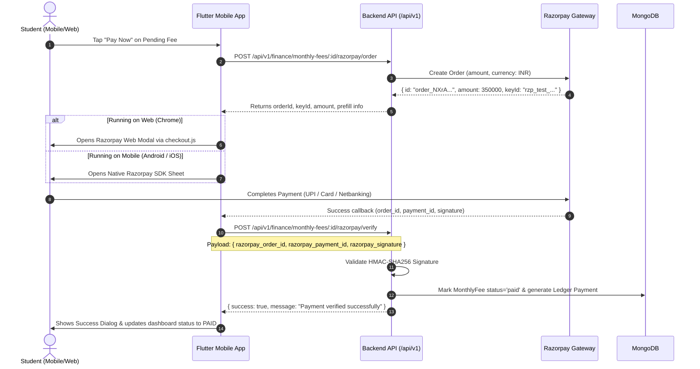

# 📱 Sports Academy Mobile App

A cross-platform Flutter mobile & web application for Sports Academy students, trainees, and parents to manage training schedules, attendance logs, sibling profiles, and coaching fee payments via Razorpay.

---

## 🚀 Key Features

- **Trainee Authentication**: Instant login by Student Registration Number (`regNo`) without needing complex academy slugs.
- **Multi-Child Sibling Switcher**: Switch between family child profiles with one tap.
- **Attendance & Biometric Logs**: Real-time attendance percentage, check-in history, and session logs.
- **Court & Slot Bookings**: Live availability slots queried from backend `/api/v1/sports` and `/api/v1/slots`.
- **💳 Razorpay Fee Payments**: Full two-step secure payment flow supporting UPI, Cards, and Netbanking on both **Flutter Mobile (Android/iOS)** and **Flutter Web (Chrome)**.

---

## 💳 Razorpay Gateway Architecture & Diagnostic Guide

### Why was Razorpay not opening originally?

1. **Frontend Platform Support**:
   - The standard `razorpay_flutter` package only implements native Android & iOS method channels. When run in Chrome (`flutter run -d chrome`), calling native methods threw `MissingPluginException: No implementation found for method resync on channel razorpay_flutter`.
   - **Resolution**: Implemented a conditional Web JS-Interop bridge (`razorpay_bridge_web.dart` + `web/index.html` with `checkout.js`). Flutter Web uses Razorpay Checkout Web JS, while Android/iOS use native channel bindings.

2. **Backend API Key Validation**:
   - In development environments where `RAZORPAY_KEY_ID` is set to `rzp_test_mock`, Razorpay's official CDN SDK refuses to initiate a transaction because it is not a valid format (`rzp_test_...`).
   - **Resolution**: Integrated an interactive developer sandbox fallback popup when running on mock credentials, allowing seamless local development and automated testing without requiring live API keys.

---

## ⚙️ Environment Configuration

To enable live/test Razorpay payments:

1. Add your Razorpay API test credentials to `backend/.env`:
   ```env
   RAZORPAY_KEY_ID=rzp_test_xxxxxxxxxxxxxx
   RAZORPAY_KEY_SECRET=your_razorpay_key_secret
   RAZORPAY_WEBHOOK_SECRET=your_webhook_secret
   ```
2. Restart the backend:
   ```bash
   npm run dev
   ```

---

## 🔄 Razorpay Payment Workflow (Two-Step Verification)



---

## 🧪 Running Tests

```bash
flutter analyze
flutter test
```

